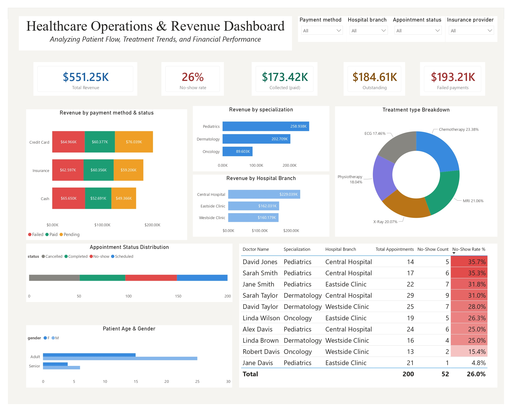
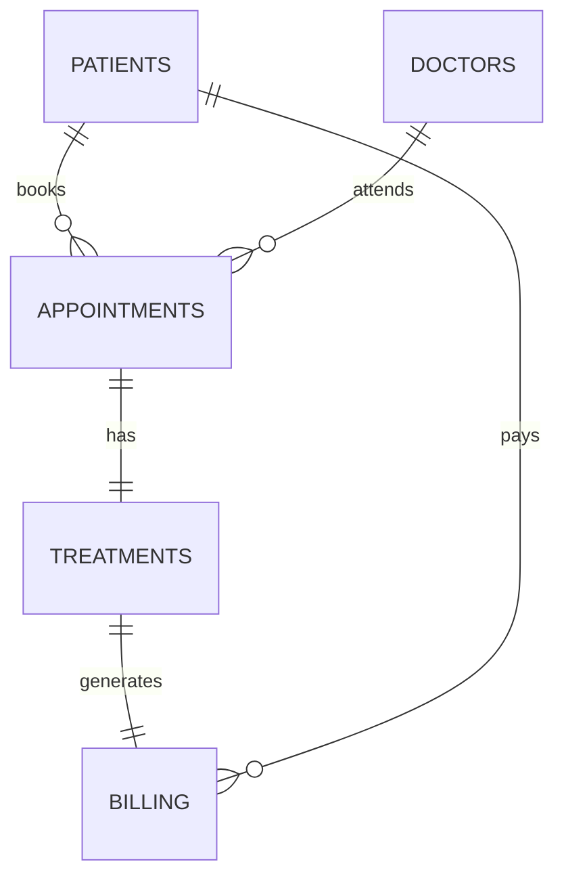

# Hospital Management Data  
---

## Dashboard Preview

---
# 🏥 Hospital Management Data Analysis

An end-to-end analysis of a five-table hospital database (patients, doctors, appointments, treatments and billing) to understand appointment outcomes, billing and payment performance, and where revenue is being lost.

---

## 🎯 Project Overview

Hospitals depend on completed appointments and collected payments. This project links appointment, treatment and billing records to answer four questions:

1. How many scheduled appointments are actually completed?
2. How much of the billed amount is collected, and how much is lost or outstanding?
3. Do doctors, branches, treatments or patient groups differ in outcomes?
4. What should the hospital change first to reduce leakage?

---

## 🗂️ Dataset

| Table | Rows | Description |
|---|---|---|
| `patients` | 50 | Demographics, age group, insurance provider, registration date |
| `doctors` | 10 | Specialization (Pediatrics, Dermatology, Oncology), branch, years of experience |
| `appointments` | 200 | Date, time, reason for visit, status (Completed / No-show / Cancelled / Scheduled) |
| `treatments` | 200 | Treatment type, description, cost, date |
| `billing` | 200 | Bill amount, payment method, payment status (Paid / Pending / Failed) |

**Period covered:** January – December 2023 · **Branches:** Central Hospital, Eastside Clinic, Westside Clinic

### Table relationships

All patient, doctor, treatment and bill IDs match across tables. There are no missing values or duplicate records.

---

## 🔧 Approach

1. **Cleaning:** removed stray spaces from column names (`amount`, `cost`) and converted amounts stored as text with thousands separators into numbers.
2. **Joining:** linked appointments → treatments → billing → patients and doctors. All 200 records joined cleanly, and the treatment cost equalled the billed amount in every case.
3. **Exploration:** calculated status, payment and revenue metrics overall and by doctor, branch, specialization, treatment type, reason for visit, patient age group, gender, insurance provider and month.
4. **Statistical testing:** chi-square tests for categorical comparisons and Kruskal–Wallis tests for cost comparisons, using a 5% significance level.
5. **Data-quality checks:** compared statuses, dates, specializations and registration dates across tables to find inconsistencies.

**Tools:** Python (pandas, SciPy).

---

## 📊 Key Findings

### Headline numbers

| Metric | Value |
|---|---|
| Appointments | 200 (48 of 50 patients have visits, about 4.2 each) |
| Completed | 46 (23.0%) |
| No-Show | 52 (26.0%) |
| Cancelled | 51 (25.5%) |
| Still marked "Scheduled" | 51 (25.5%) |
| Total billed | 551,250 (average bill 2,756) |
| Bills paid | 64 (32.0%), worth 173,425 (31.5%) |
| Bills pending | 69 (34.5%), worth 184,612 (33.5%) |
| Bills failed | 67 (33.5%), worth 193,213 (35.0%) |

### Where the billed value sits

| Appointment status | Bills | Billed amount | Share of total |
|---|---|---|---|
| Completed | 46 | 124,100 | 22.5% |
| No-Show | 52 | 142,678 | 25.9% |
| Cancelled | 51 | 152,045 | 27.6% |
| Scheduled | 51 | 132,427 | 24.0% |

### Insights

- **Only about 1 in 4 appointments was completed.** A quarter were no-shows, a quarter were cancelled, and a quarter are still marked "Scheduled" even though every one of them is dated in 2023, so those statuses look out of date.
- **Every appointment has a treatment and a bill, whatever its status.** 77.5% of the billed value is attached to cancelled, missed or never-updated appointments.
- **Collection is weak.** Only about one third of billed value has been paid. Even for completed visits, just 14 of 46 bills (31,063 out of 124,100) are paid, leaving 93,037 outstanding.
- **Payment does not depend on the visit.** 35 bills worth 90,198 are marked as paid for cancelled or no-show appointments, and payment status is unrelated to appointment status (p = 0.998) or to payment method (p = 0.88).
- **Treatment costs are similar across types.** MRI has the highest average cost (3,225) and ECG the lowest (2,532), but the differences are not significant (p = 0.17). Chemotherapy is the most common treatment (49 cases, 128,856 in total).
- **A pricing anomaly:** "Basic screening" (average 3,149) costs more than "Advanced protocol" (2,522), p = 0.02.
- **Emergency visits have the highest average bill (3,186)** and follow-ups the lowest (2,427).
- **No doctor, branch or specialization differs significantly** in completion, no-show or payment rates (all p > 0.3). Dr. D005 has the busiest schedule (29 appointments) and the lowest completion rate (13.8%), while D007 has the highest (38.5%) but only 7.7% of bills paid. Central Hospital has the highest no-show rate (31.0%).
- **Seniors and women are worth watching.** Seniors have a 40.6% no-show rate vs 23.2% for adults, and women cancel more often than men (35.7% vs 20.0%), but group sizes are small and the differences are not statistically significant.
- **Revenue is not concentrated.** The top five patients account for 21.3% of billed value.

---

## ✅ Recommendations

1. **Bill only completed visits.** Generate a bill only when an appointment is marked "Completed".
2. **Review the 35 bills paid for cancelled or no-show appointments (90,198).** Confirm whether they are valid fees (such as late-cancellation charges), refunds due, or data errors.
3. **Clean up appointment statuses.** Update all past-dated "Scheduled" appointments, and add an automatic flag for any that stay open after their date.
4. **Start a structured collections process.** Prioritise the 93,037 outstanding on completed visits, then failed (193,213) and pending (184,612) payments, with reminders, retries and payment plans.
5. **Investigate failed payments.** Record failure reasons and verify insurance coverage before treatment where possible.
6. **Reduce no-shows and cancellations.** Use SMS or email reminders, easy rescheduling and a waitlist, with extra outreach for senior patients.
7. **Balance doctor workloads.** Review scheduling and capacity, especially at Central Hospital and for D005.
8. **Standardise treatment pricing.** Set clear price bands per treatment type and fix the "Basic screening" vs "Advanced protocol" inconsistency.
9. **Track key metrics monthly.** Completion rate, no-show rate, billed vs collected, days to payment and outstanding balance by age. Collect at least two years of data before judging individual doctors or branches.

---

## 🏁 Conclusion

The central issue in this data is **revenue and operational leakage**. Only 23% of appointments were completed, yet 100% were billed, and only 32% of billed value has been paid. Payment outcomes do not follow visit status, payment method, doctor, branch or treatment type, so the problem points to process (billing triggers, status updates and payment follow-up) and not to a particular group or clinician.

The most valuable next steps are to bill only for completed care, clean up stale appointment statuses, reconcile payments received for visits that never happened, and set up a structured collections and reminder process.

---

## ⚠️ Limitations

- **Small sample.** 200 appointments, 50 patients and 10 doctors in a single year mean most subgroup comparisons are underpowered and not statistically significant.
- **The data looks synthetic.** Status, payment status and payment method are split almost evenly, cost equals billed amount exactly, and every appointment has exactly one treatment and one bill. Names do not match gender, and Pediatrics doctors (5 of 10) only see patients aged 20–76.
- **Inconsistencies between tables.** All appointments are billed regardless of status, 44 of 49 chemotherapy treatments are delivered by Dermatology or Pediatrics doctors, and 28 appointments are dated before the patient's registration date.
- **Statuses may be out of date.** All "Scheduled" appointments fall in 2023, so the real completion rate could be higher than 23%.
- **Billing interpretation.** The analysis assumes each bill is the charge for its linked appointment. If bills include cancellation fees or deposits, some findings about billing for non-completed visits would differ.

> **Note:** because of the synthetic nature of the data, the findings are illustrative and should not be treated as real hospital performance.
---

## Author

Adriane Clark Ballesteros  
Healthcare Data Analyst Trainee

* 🔗 GitHub: https://github.com/acbshields12

---

